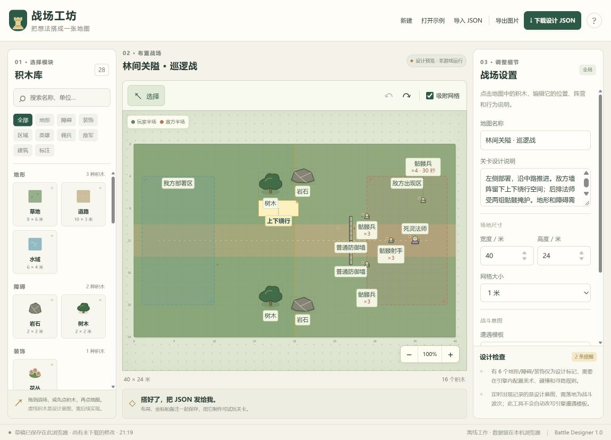

# 战斗场地设计与模块化交付

推荐先用草图表达想法，再用战场工坊确定位置与规则。纸笔和工坊都可以作为交付入口；结构化设计文件更适合反复调整、复用模块和协作者交接。你负责决定战斗体验，我据此完成引擎内的关卡构建与试玩验证。

## 用纸笔设计

俯视画出战场边界，默认左侧玩家、右侧敌军。格纸每格 1 米最方便；没有格纸时，标一段已知长度，例如一面墙长 3 米。只需方块、圆圈、箭头和文字，不需要绘画技巧。

建议至少标明以下内容：

| 内容 | 简单写法 |
| --- | --- |
| 部署区 | 左侧画虚线框，写“玩家自由部署”或“英雄固定在①” |
| 障碍规则 | “石头不可破坏、不能穿过”；“树林只是装饰，可以穿过” |
| 敌军 | “骷髅兵 ×6，开局出现”；“死灵法师 ×1，30 秒后出现” |
| 墙和建筑 | 写名称、阵营、朝向；说明开局已建成还是需要施工 |
| 战术意图 | “中路危险但短，上下两侧可以绕行” |
| 必须保留的设计 | 用星号标记“此处通道必须至少 3 米宽” |

密集说明用①②③写到图旁，箭头标出对应位置。拍照尽量正对纸面、保留四个角、避免阴影遮字。手写标注能够辨认时可以直接使用；歧义、缺少尺寸或看不清的字会先整理成待确认项，不默默猜成最终玩法。

[可打印草图纸](../Tools/BattleDesigner/paper-template.html) 为 A4 横向版，提供 40 × 24 格战场、图例和备注区。浏览器点击“打印 / 保存 PDF”即可使用。

## 使用战场工坊

打开 [Tools/BattleDesigner/index.html](../Tools/BattleDesigner/index.html)，也可以在资源管理器里直接双击。保持整个 `BattleDesigner` 文件夹完整，无需安装依赖、启动 UE 或联网。界面采用当前项目的墨绿、羊皮纸和金色。

1. 首次打开会显示“高地伏击”示例；已有浏览器草稿则继续恢复。点击“新建”开始自己的地图，或直接修改示例。
2. 从左侧拖入积木；也可以点选积木，再点击地图放置。
3. 选中积木后，在右侧修改位置、尺寸、朝向、阵营、数量、出现时间和备注。数值单位是米。
4. 用 Q/E 每次旋转 15°，Ctrl+D 复制，Delete 删除，Ctrl+Z 撤销，Ctrl+Shift+Z 重做。文本框内输入不会触发这些地图快捷键。
5. 在“增援波次”设置定时、英雄首次低血量或首次死亡后的增援；在“敌方牌组”设置付费出牌与银币。阅读“设计检查”，越界、非法数字或损坏的英雄引用会被拒绝。
6. 点击“下载设计 JSON”保存可再次编辑的源文件；“导出图片”便于讨论。下次通过“导入 JSON”继续修改。

浏览器会自动保存本地草稿，但草稿不等于可随身携带的文件。换浏览器、换设备或发给协作者前，下载 JSON。导入错误文件不会替换当前布局；损坏的旧草稿会保留并提示处理。

v2 提供 32 种模块，在初版 28 种的基础上增加草丛、沼泽、军营篝火与高山。常用防御墙、法师塔、治疗站、攻城车与亡灵敌军都已映射到现有单位 ID。波次另提供全部 46 个规范单位 ID，敌方牌组提供 48 张已注册卡。角色与建筑的模块占地是设计尺寸，不会直接修改游戏单位数值或碰撞半径。

## 从设计制作可试玩关卡

把 JSON 发给我，同时附一句体验目标，例如：“这关要让玩家利用上下两条路线绕过城墙，战斗约 4 分钟。”也可以附预览图。若使用纸笔，先发照片；我可以把照片整理为同一种结构化设计再与你核对。

现有标准模块已接入设计 JSON 的引擎加载桥：读取布局、生成地形与单位、安装事件波次和敌方经济。UE 5.8 项目编译完成后，从项目根目录运行 `Scripts/PlayBattleLayout.ps1 -Layout "你的设计.json"` 即可交给独立测试战场；具体规则、脚本参数与验证状态见 [战场地形与敌军遭遇编辑](62-TerrainAndEncounterDesigner.md)。新增标准模块之外的自定义规则，仍需先明确效果再接入代码。

**工坊在浏览器中编辑，独立脚本负责进入 UE 试玩。** 它不会导出 `.umap`。草地、道路、水域、花丛是静态装饰；岩石和树木是不可破坏障碍；四种新地形遵循文档 62 的规则。我方部署区实际约束开局部署；敌方出现区和文字仍仅作标注。缩放单位图标不改变其战斗数值或碰撞体。

为了让后续搭建越来越快，建议先制作一张完整关卡并积累经过验证的模块，例如“3 米石墙”“可绕行岩石群”“亡灵双路入口”。相同模块在多关复用，数值与规则保留统一来源。UE 的 Level Instance 可以重复放置一组 Actor，适合作为以后复用场景组合的基础；本项目的战斗碰撞和索敌仍需由现有 C++ 规则接入。[Epic Level Instancing 文档](https://dev.epicgames.com/documentation/unreal-engine/level-instancing-in-unreal-engine?lang=en-US)

## 数据接口与协作记录

初版在 v0.8.4 之后新增 `Tools/BattleDesigner` 离线工具及本文；v2 的四地形、波次、经济与引擎桥修改记录见文档 62。浏览器设计器不读写游戏存档；导出的配置由独立测试战场加载。

| 文件 | 职责 |
| --- | --- |
| `index.html` / `style.css` / `app.js` | 界面、SVG 地图、操作历史、本地草稿、文件导入导出与 PNG |
| `model.js` | 32 模块目录、数据校验、v1 迁移、示例、JSON 序列化和 UE 坐标映射，无浏览器依赖 |
| `catalog.js` / `units.js` | 分别提供规范卡牌与增援兵种目录 |
| `schema.json` | `little-king.battle-layout` v2 的结构约定 |
| `model.test.cjs` | 回读、非法输入、完整占地边界、原型污染字段、坐标等回归 |
| `paper-template.html` | A4 横向草图模板 |

设计坐标原点为地图左上角，`x` 向右、`y` 向下，位置表示模块中心。当前默认宽 40 米、高 24 米，对应 `ULKGameData` 的 Y 方向全长 4,000 厘米与 X 方向全长 2,400 厘米。转换公式：`UE.X=(height/2-y)*100`，`UE.Y=(x-width/2)*100`，`UE.Z=0`。屏幕顺时针旋转对应 `UE.Yaw=90+rotation`；水平墙的前方由朝向箭头表示。

格式记录地图名称、描述、尺寸、网格、遭遇意图、随机种子，以及每个对象的稳定 ID、模块 ID、位置、大小、旋转、阵营、数量、出现秒数和备注。v2 增加 `enemy` 经济与牌组、`waves` 事件增援。现有单位采用明确的 `unitId` 映射，模型不会凭字符串猜未知游戏类型。文件大小上限 2 MiB、最多 500 个对象；单个地图群组最多 20 个单位，波次单条最多 50 个。编辑器群组并不绕过游戏自身单位上限。

帮助中的“Unreal 坐标对照”供开发人员核对世界坐标，不替代可编辑设计文件，也不等于 `.umap`。运行 `node --test Tools/BattleDesigner/model.test.cjs` 可验证数据模型；无需为网页工具重建 UE。

## 示例与验证

[林间关隘示例](../Tools/BattleDesigner/examples/forest-pass.json) 包含 16 个对象，可以通过“导入 JSON”打开并迁移。它展示中央关隘、上下绕行空间、后排死灵法师与延时骷髅援军。[高地伏击示例](../Tools/BattleDesigner/examples/terrain-ambush.json) 演示 v2 新地形、三种波次和付费出牌。

初版通过 20 项数据模型测试及界面脚本语法检查，并实测放置、拖动、坐标修改、旋转、复制、撤销、PNG 导出、JSON 下载及重新导入；导出的预览图为 2,000 像素宽。v2 已扩充到 35 项模型测试，游戏与新页签的验证记录见文档 62。草图模板已检查屏幕排版，实际打印效果尚未验证。浏览器自动化环境限制直接访问 `file:`，因此双击本地 HTML 的方式仅做了静态依赖检查；交互验证通过本地 HTTP 预览完成。工具本身不依赖网络资源。

初版未修改游戏 C++；v2 已增加引擎加载桥及地形、波次规则，并完成地形、路由、出生占位、条件触发与独立试玩的相关自动化及存档哈希检查。实际关卡的长局平衡仍需试玩；已完成的测试和边界以文档 62 的集成记录为准。v2 随 [v0.8.5](63-v0.8.5ReleaseNotes.md) 发布。

