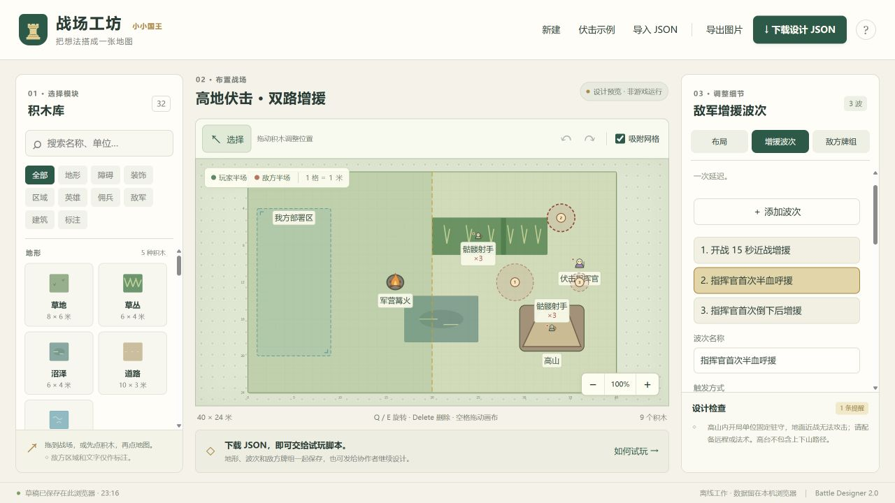
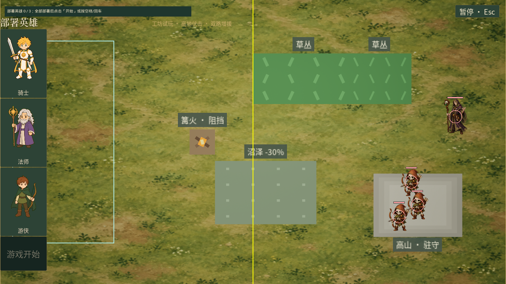
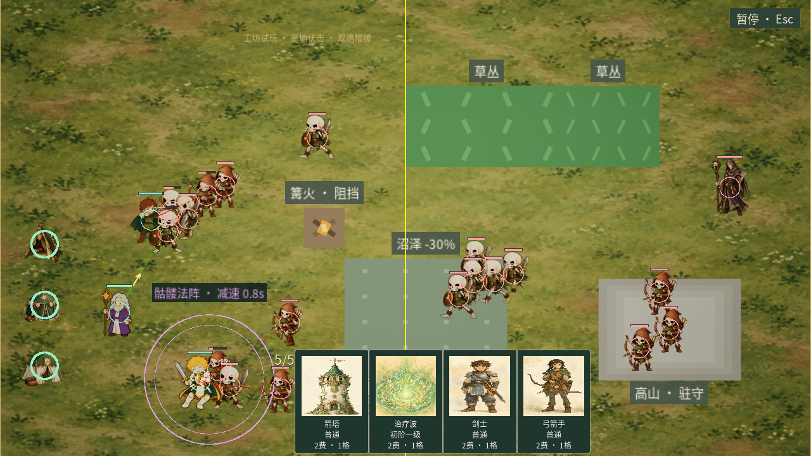

# 战场地形与敌军遭遇编辑

战场工坊 v2 把地形规则、事件增援和敌方银币出牌放进同一份设计 JSON。关卡设计者可以布置战场，再在右侧“增援波次”“敌方牌组”页签调整战斗节奏。引擎加载桥将设计坐标转换为实际地形、开局单位与遭遇配置；工坊本身仍是离线编辑器，不在浏览器运行战斗。

本轮工作随 v0.8.5 发布，主要新增战场编辑器及配套游戏规则。原有纸笔设计方法继续适用，见 [战斗场地设计与模块化交付](61-BattleLevelDesignWorkflow.md)。版本范围见 [发布记录](63-v0.8.5ReleaseNotes.md)，后续协作入口见 [项目交接](64-ProjectHandoff.md)。

## 四种地形规则

| 地形 | 初版行为 | 设计注意 |
| --- | --- | --- |
| 草丛 | 草丛内单位对片外敌人隐身；同一连通片内的单位互相可见 | 相接或重叠的草丛属于同一片，可用多个旋转矩形搭不规则草丛 |
| 沼泽 | 区域内单位移动速度乘以 0.7，离开后恢复 | 多块沼泽重叠不重复叠乘；不直接降低攻击速度 |
| 军营篝火 | 不可攻击的实体装饰，单位必须绕行 | 没有血量、伤害、回血或阵营增益，不是新的可出牌建筑 |
| 高山 | 不可通行的固定高台，上方单位驻守原位 | 不提供上下山路径；处理山上敌人需要远程单位或法术 |

草丛采用已确认的初版规则：单位在草丛中向该连通草丛之外的敌人攻击时，自身以及周围 2 米内的己方草丛单位暴露 3 秒。再次向外攻击会延续暴露；未参与攻击但位于附近的友军也可能被发现。范围以单位当前位置计算。己方单位不会因己方草丛对自己隐藏，敌方不可见单位不应继续被自动锁定。草丛隐身与黑云法术的隐藏状态分别管理，暴露草丛单位不会直接清除黑云。

沼泽预留单位适应性接口 `ALKUnitBase::SetSwampMovementMultiplier`。普通单位为 `0.7`；以后可将免疫单位设为 `1.0`，适应沼泽而加速的单位设为大于 `1.0`。本轮不新增带有这些能力的卡牌，也不在地图文件中替单位修改能力。

高山采用平面战斗坐标与高地规则，不切换成可以攀登的 3D 地形。在地图里把远程单位放入高山轮廓内，即可表达高台驻军。地面近战不能攻击高台驻军；远程攻击、远程技能与法术遵循现有命中和效果逻辑。驻军不会自动下山，也不接受普通移动或强制位移。高山没有血条，不能打碎。场地设计必须给玩家处理驻军的手段，避免只能携带近战却必须击败高台单位的关卡。

四种地形均可在工坊调整位置、尺寸和旋转。角色与建筑的图中占地仍是设计尺寸，不能通过拉大图标直接提升其生命、射程或碰撞体。草丛与沼泽为区域；军营篝火与高山为实体障碍，需要同时参与寻路、出生与放置检查。

原有积木也有明确的导入行为：草地、道路、水域、花丛生成静态装饰，不额外加减速或隐身；树木与岩石是不可破坏的实体障碍。我方部署区实际限制英雄、佣兵和建筑的部署区域，并继续遵守己方半场与碰撞规则；法术保留原有施法范围规则。敌方出现区、文字标注只表达设计意图，不自动下兵。地图尺寸会同步到测试战场边界和镜头。

## 敌军的两种来源

**事件增援**按关卡安排免费生成敌军，不扣除银币。**敌方牌组**通过回复银币、支付卡牌费用生成单位或施放法术。两者可以同时开启，也可以关闭牌组，让关卡只使用开局敌人与事件增援。

编辑的是敌方可使用的牌组，不是强制安排每次出牌顺序。当前沿用已有出牌策略，后续卡池扩充后再调整战术选择。事件增援中的单位 ID 与卡牌 ID 分开，例如普通防御墙的单位是 `Unit_WallCommon`，卡牌则是 `Card_WallCommon`。

### 编辑增援波次

1. 在地图放置开局敌方英雄或首领。若希望以某名英雄为条件，保持该对象数量为 1、出现时间为 0。
2. 点击右侧“增援波次”，再点击“添加波次”。
3. 选择触发方式、兵种、数量与时间；条件波次还需选择地图中的具体英雄。
4. 填写落点 X/Y 或点击“在地图选落点”，随后在地图点击目标位置。
5. 设置分散半径。编号圆圈表示生成锚点与搜索范围，实际落点还会检查可用空间。
6. 下载设计 JSON。删除被引用的英雄前，先改动或删除对应波次；编辑器会拒绝悬空引用。

| 字段 | 意义与合法值 |
| --- | --- |
| `id` | 波次稳定 ID，与其他波次、地图对象不重复 |
| `label` | 显示名称，1～100 字符 |
| `trigger` | `time`、`hero-health-below`、`hero-first-death` |
| `time` | 0～3,600 秒；定时波次为开战后的秒数，条件波次为条件首次满足后的延迟 |
| `targetId` | 引用地图英雄对象的 `id`；定时波次必须为空字符串 |
| `healthThreshold` | 0.01～0.99；界面用 1%～99% 显示，只有半血类触发使用 |
| `unitId` | 已登记的规范单位 ID；当前提供全部 46 种英雄、佣兵、召唤单位与建筑 |
| `count` | 1～50 |
| `x` / `y` | 地图左上角为原点的米坐标，位于战场内 |
| `radius` | 0～10 米，生成分散与可用位置搜索半径 |

全部触发以正式开战为起点，部署阶段不消耗波次计时。每条波次仅登记、执行一次。

- **定时**：`time: 15` 表示开战第 15 秒生成。
- **首次低于血量阈值**：`healthThreshold: 0.5`、`time: 2` 表示指定英雄生命比例首次严格低于 50% 后等待 2 秒生成。恢复到 50% 以上再下降不会重复触发；正好 50% 不满足“低于”。
- **首次死亡**：`time: 1` 表示该地图实例首次倒下后等待 1 秒生成。英雄以后复活、再次倒下不重复触发。它不是“每当同名英雄死亡”，不会被另一名相同兵种的单位替代。

波次由英雄对象实例 ID 绑定，不是用名称猜目标。当前只引用单独布置、开局出现的英雄或首领，不支持引用“某一波未来生成的第几名英雄”或复杂多条件组合。

生成仍受场上人数与可用位置限制。空间不足或单位上限已满时，运行时保留有限延后窗口，当前为 3 秒；超过窗口仍未生成的数量会丢弃并记录日志，避免后续突然倾倒大量积压单位。分散半径为 0 时只尝试精确锚点，不会忽略碰撞。

自定义地图的胜利条件包含清除敌军与处理剩余增援。尚未到时间的定时波次、已满足条件但仍在延迟中的波次，以及等待可用位置的增援，都会参与结束判断；不能只击败开局英雄就跳过这些敌军。未触发且已不可能触发的条件不会让战斗一直等待。

### 编辑敌方牌组和银币

右侧“敌方牌组”页签可从 48 张已登记卡牌中勾选，没有自由输入未知 ID 的入口。同类卡牌只保留一张。关闭主动出牌会保留已选牌组，便于比较同一地图使用或不使用经济系统的差别。

| 字段 | 默认值 | 范围 |
| --- | --- | --- |
| `enemy.usesCards` | 关闭 | 布尔值 |
| `enemy.cards` | 骷髅兵、骷髅射手、骷髅法阵 | 已登记 CardId，不重复；开启出牌时至少一张 |
| `enemy.silverPerSecond` | 1 | 每秒 0～100 银币 |
| `enemy.silverCap` | 20 | 1～1,000 |
| `enemy.startingSilver` | 5 | 0～上限 |

把每秒银币设为 0 可以只消耗初始资金；关闭出牌开关则停止整条出牌来源。低于卡牌费用的银币上限会使敌方始终无法支付该牌，需要设计者避免这种配置。免费波次不会给敌方充值，也不受是否选中同名卡牌限制。

## 示例与试玩入口

点击工坊顶部“伏击示例”，或导入 [terrain-ambush.json](../Tools/BattleDesigner/examples/terrain-ambush.json)，可打开“高地伏击 · 双路增援”。示例包含：

- 两块连通草丛与伏兵；下路沼泽；中路阻挡篝火；高山骷髅射手。
- 开战 15 秒的近战增援。
- 指挥官首次低于 50% 生命后延迟 2 秒的射手增援。
- 指挥官首次倒下后延迟 1 秒的骷髅巨人增援。
- 每秒 1.5 银币、上限 20、初始 5 的敌方牌组。

项目使用 UE 5.8，本轮已使用 UE 5.8.1 完成 Development 编译。在项目根目录 `E:\little_hero\little_king` 打开 PowerShell，运行：

```powershell
# 打开随项目附带的高地伏击示例
.\Scripts\PlayBattleLayout.ps1

# 打开自己从工坊下载的文件
.\Scripts\PlayBattleLayout.ps1 -Layout "C:\Users\userl\Downloads\我的战场.json"
```

脚本默认使用 `E:\epic\UE_5.8`，引擎安装位置不同时加 `-EngineRoot "你的 UE_5.8 目录"`。普通试玩先手动部署英雄；`-AutoStart` 用于自动开始的测试场景。此入口启动独立战场，不需要先从家园开始远征，也不创建家园或远征存档。浏览器“Unreal 坐标对照”不是试玩入口，脚本使用普通“下载设计 JSON”。

当前提供独立关卡试玩入口，尚未把设计文件自动分配到随机远征节点。可以先在此入口验证布局与战斗节奏，再决定在哪个区域、哪些节点使用该关卡。

## 数据格式和容量

根结构使用 `format: "little-king.battle-layout"`、`version: 2`。保留原来的 `meta`、`field`、`settings`、`objects`，新增 `enemy` 和 `waves`。最大文件 2 MiB、最多 500 个地图对象、最多 64 条波次。旧地图对象的 `spawnAtSeconds` 仍可表达敌方延时生成，也会占用运行时波次条数。

`settings.encounterId` 支持 `Patrol`、`Elite`、`Boss` 三类遭遇模板。加载时据此生成基础难度快照，再应用设计文件中的敌军布局、波次与经济。它不会凭这个字段把独立关卡接入远征路线；远征节点的关卡选择属于后续集成。

默认地图为 40 × 24 米，网格可选 0.25、0.5、1、2 米。坐标转换保持不变：

```text
UE.X = (field.height / 2 - y) × 100
UE.Y = (x - field.width / 2) × 100
UE.Z = 0
UE.Yaw = 90 + rotation
```

对象坐标表示中心，旋转为屏幕顺时针角度。整个旋转轮廓必须留在战场内。波次落点可在战场内任意位置，圆形搜索范围部分超出地图时会提醒，实际生成仍必须在可用位置。

自定义布局的初始生成受单阵营总容量、空间与英雄类型唯一性等约束；`ULKGameData` 的单阵营默认总容量为 20，计入英雄、佣兵与建筑。工坊可以描述分批出现的大量增援，但事件波次不绕过实际场上容量。

默认 3 名英雄指玩家部署限制；同类建筑 2 座主要约束正常出牌。它们不是编辑布局中所有敌方英雄或建筑的统一硬上限。工坊会提示超出常规配置的设计，是否可生成仍以自定义布局加载规则与运行时检查为准。

引擎测试关卡需要至少一名开局敌方英雄或首领。地图中的英雄数量固定为 1 且开局出现，初始敌方英雄类型不重复；后续英雄通过波次生成。延时地图对象只支持敌方。空白设计可以先保存和继续搭建，但缺少敌方开局目标时不能直接开始测试战斗。

### v1 文件和草稿迁移

导入 v1 文件时保留所有原有对象与参数，补入默认 `enemy` 和空 `waves`，再保存为 v2。默认关闭主动出牌，避免旧设计突然产生额外敌军。原有 `spawnAtSeconds` 保留。浏览器沿用原草稿存储位置，读取时迁移，不要求用户清除草稿。

迁移不会修复所有旧设计的游戏规则问题。例如多名英雄被放在同一个数量群组中，需要改为单个开局英雄或波次。新版本的明确错误会阻止导入，原文件与坏草稿仍保留；只写提醒的问题允许继续设计。

## 文件职责与协作记录

| 文件 | 本轮职责 |
| --- | --- |
| `Tools/BattleDesigner/model.js` | v2 格式、32 个积木、波次工厂、经济与英雄引用校验、迁移、坐标映射 |
| `Tools/BattleDesigner/catalog.js` | 48 个规范 CardId 和中文名，用于敌方牌组选项 |
| `Tools/BattleDesigner/units.js` | 46 个规范 UnitId，用于增援兵种，包含仅能召唤的天使 |
| `Tools/BattleDesigner/app.js` / `index.html` / `style.css` | 三页签、地形 SVG、波次圆圈、地图选点、字段编辑、完整撤销和草稿 |
| `Tools/BattleDesigner/schema.json` | v2 结构与枚举；跨字段和几何规则由模型继续校验 |
| `Tools/BattleDesigner/model.test.cjs` | v1 迁移、触发引用、卡牌/兵种目录、边界、坏数据与坐标回归 |
| `Tools/BattleDesigner/examples/terrain-ambush.json` | 四地形、三类触发与并行经济的示例 |
| `Source/little_king/ALKBattleTerrain.*` | 地形区域、连通草丛、碰撞几何、视野、地形占位表现 |
| `Source/little_king/LKBattleLayout.*` | JSON 解析、坐标转换、规范 ID 映射、生成遭遇配置 |
| `Source/little_king/ALKBattleGameMode_Layout.cpp` | 应用布局、部署区域限制、初始单位与营地生成、独立试玩入口 |
| `Scripts/PlayBattleLayout.ps1` | 指定设计 JSON 与引擎位置，启动独立试玩战场 |
| `Source/little_king/ALKOpponentBrain.*` | 事件记录、一次性波次调度、落点、容量等待与付费出牌并行 |
| `Source/little_king/Tests/LKTerrainTests.cpp` / `LKScenarioWaveTests.cpp` | 引擎地形与波次行为回归，由集成流程统一执行 |
| `Source/little_king/Tests/LKBattleLayoutTests.cpp` | JSON 解析边界、实际布局生成、部署与死亡增援胜利判断 |

角色的发现、索敌、近战伤害资格、移动与位移会调用地形规则；地图编辑器只编辑配置，不直接修改单位永久能力或玩家存档。新增卡牌或单位时，需要同步对应目录；模型测试会与 C++ 注册内容比对，漏更新会直接报错。`Unit_WallCommon` 与 `Card_WallCommon` 等不同接口的 ID 必须保持区分。

## 表现素材与验证

工坊使用代码绘制的 SVG 图形，游戏中使用代码构建的几何体与项目已有材质表现草丛、沼泽、篝火和高山。本轮没有新增外部下载素材，也未调用图像或音乐生成模型，因此没有新增素材授权条目或生成提示词。颜色与形状用于区分规则，精细美术可在保持碰撞与地形接口不变的前提下替换。

本轮验证结果：

- UE 5.8.1 Development 编译成功。
- 全量 `LittleKing` 自动化测试 **169/169 通过**，其中 90 项无警告、79 项含既有测试警告。
- 最终布局模板调整后，`LittleKing.Scenario` 针对性回归 **8/8 通过**。
- 编辑器 **35/35 Node 回归通过**，`app.js` 语法检查通过。
- 浏览器检查了波次编辑/撤销、敌方卡牌勾选、银币修改、非法精度拒绝、JSON 下载和重新导入；三类波次与经济参数回读一致。
- 已实际启动 UE 部署与战斗：四地形生成，草丛伏兵隐藏、高台驻军可见；开战第 15 秒的免费波次生成 5 名骷髅兵，付费卡牌与骷髅法阵同时运行。
- 试玩和自动化前后已有 6 个存档 SHA-256 均一致，存档总数保持 6。

详细记录见 [TerrainDesigner-Validation.json](validation/TerrainDesigner-Validation.json)。运行日志和完整 UE 报告保留在本机 `Saved/Logs/Terrain*`、`Saved/Automation/TerrainDesigner*`。首次全量运行暴露的新测试夹具重复数组元素断言已修复，修复后完成上述全量及最终针对性回归。关卡的战斗难度和路线体验仍需设计者按实际卡组试玩调整。

工坊波次编辑：



实际 UE 部署画面（草丛中的敌军已隐藏）：



实际开战 18 秒画面（包含免费增援、银币出牌和骷髅法阵）：


