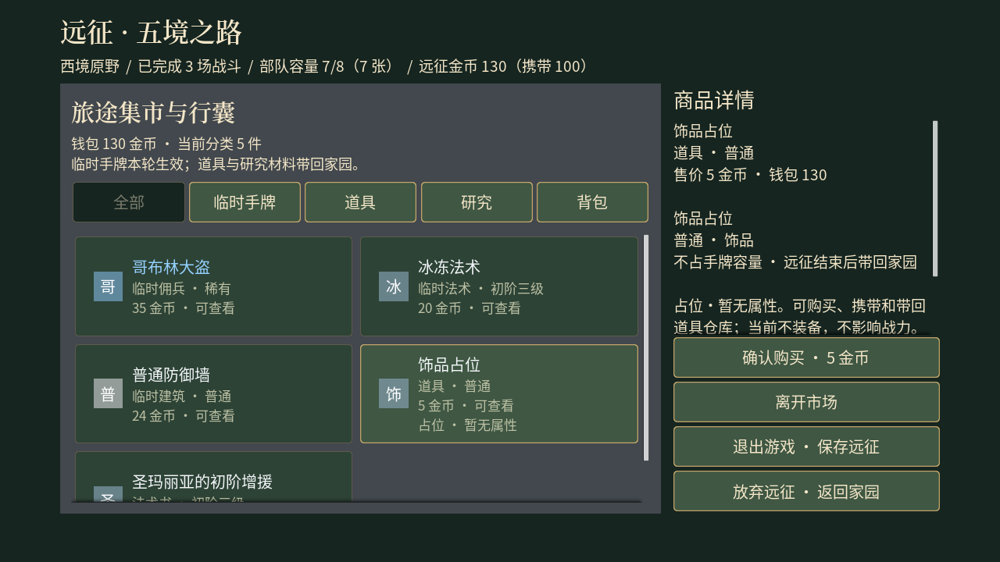
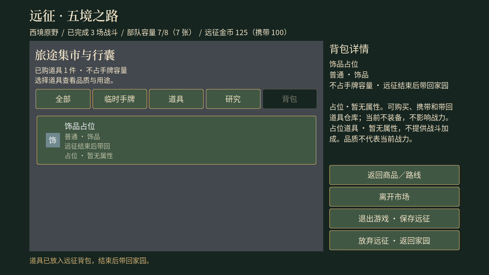

# v0.8.6 · 市场、AI 与表现优化

开始日期：2026-10-10。基线为 v0.8.5，依据 [GitHub 调研与建议](GitHubResearchAndRecommendations.md) 和本轮用户授权实施。此前文档整合与协作者修改保留。此页集中记录本阶段设计、进展与最终验证，现行规则已同步至对应主题文档；本阶段于 2026-10-10 发布为 v0.8.6，工程版本为 `0.8.6`。

## 目标与阶段

| 阶段 | 工作 | 完成标准 | 状态 |
| --- | --- | --- | --- |
| 1 | 基线、数据契约、玩家存档保护 | 核查源码版本，记录原存档哈希，确定模块边界与迁移方案 | 完成：保留 6 个既有存档的 SHA-256 基线 |
| 2 | 市场经济、AI、动画并行实现 | 可编译实现及相关规则测试，独立接口可联调 | 完成：构建及相关回归通过 |
| 3 | 界面、购买/带回/研究流程、观测与关卡校验 | 玩家能完成新流程，异常有清楚反馈，数据可分析 | 完成：真实事务、界面与两种分辨率画面已检查 |
| 4 | 统一构建、回归、画面检查与文档 | 报告实际结果，修复发现的问题，既有玩家存档保持原样 | 完成：UE 193/193、Node 37/37，六份原存档不变 |

分工：市场与存档后端、AI 决策、动画表现各由独立代理实现；主代理负责设计整合、界面、观测/校验、构建和最终回归。构建与 UE 测试统一串行执行，避免占用同一引擎/输出目录。

## 已确定的设计

- **临时手牌**：市场包含佣兵、法术、建筑，加入当前远征牌组，沿用容量与替换规则；不改变永久解锁。
- **道具**：使用独立 ItemId、实例 ID、品质与道具类别，购买进入远征背包，终态带回家园。饰品/装备占位品明确标注暂无属性，不参与战斗数值；以后可替换定义与表现而保持身份。道具不占手牌容量。
- **研究**：法术书/建筑图纸进入研究材料；减少重复与极端等待，按地区提供可追求内容并调整价格至实际购买力范围。
- **生成与存档**：保留旧枚举数值和既有商品快照，新增规则版本与独立随机流；迁移、扣费、购买、带回和研究保持幂等及失败回滚。
- **AI**：公平观察、按效果评分、短期战术意图与有限思考预算；免费波次和付费出牌仍遵守关卡规则。
- **动画**：保留实际位移步态、脚底排序与权威伤害，增加作者可配置步幅、帧时长、接触事件及动作取消语义。
- **验证与平衡**：先用实际数据评估，不盲目统一提高/降低所有属性。长期骨骼换装、学习型 AI 和导航整体替换需要独立收益证据，不作为本阶段的前置工作。

## 市场定稿

新市场 Generation 2 在首次到店时生成，最多五个栏位：临时佣兵／法术／建筑优先各一、道具一、研究一。临时类别耗尽时可从其他合格临时类别补位；合格池全空时留空。每栏使用独立随机流；内容由种子和节点确定，事务及道具实例身份由完整 RunId、NodeId、种子和用途生成 128 位哈希，避免将永久身份限制在 32 位随机流状态空间；改变 RunId 不改变同种子商品内容。

深度 0～3 指本轮四个经过地区的进度，两个分支地区属于同一深度。佣兵先按品质分配概率质量，再在该品质的合格成员中分配，新增同品质角色不会挤高该品质总概率。费用超过本轮银币上限、已在牌组中的卡不进入临时池；被筛掉的品质会重新归一，因此下表是过滤前基准，不能直接当成所有战备的实际出现频率。

| 地区深度 | 佣兵：优秀／稀有／史诗 | 道具：普通／优秀／稀有／史诗／传说 |
| --- | --- | --- |
| 0 | 80% / 20% / 0% | 80% / 20% / 0% / 0% / 0% |
| 1 | 60% / 35% / 5% | 55% / 35% / 10% / 0% / 0% |
| 2 | 40% / 45% / 15% | 25% / 40% / 30% / 5% / 0% |
| 3 | 25% / 50% / 25% | 10% / 25% / 40% / 20% / 5% |

研究栏位在有候选时必出一件，法术书和图纸共用一栏。优先最高已到达的合格深度，按目录权重选具体材料，耗尽才回退低档；永久解锁、出征前已有材料和本轮已购买材料会被排除。这样每轮都有长期成长选择，不再叠加 1%／0.5% 入口与极低高阶权重。研究不受本轮银币上限过滤，详情提示解锁后的使用条件。

| 商品 | 定价 |
| --- | --- |
| 临时佣兵 | 10 + 银币费用 × 5 + 品质加价（优秀 0、稀有 5、史诗 10） |
| 临时法术／建筑 | 12 + 银币费用 × 4 + 最早地区深度 × 5 |
| 饰品／装备占位品 | 普通至传说为 5 / 8 / 11 / 14 / 17 金币；无战力，因此保持低价 |
| 法术书／图纸 | 25～180 金币，具体定价见内容图鉴；旧库存不改价 |

临时手牌加入本轮循环牌组，容量不足时先明确选弃牌，再提交一次保存事务。道具使用 ItemId + 实例 GUID + 品质，不与卡牌身份混用；出售、装备和属性系统不在当前占位实现中。书籍／图纸依旧是材料，带回图书馆消耗一本永久解锁，不额外收研究费。成功／放弃带回钱包 100%，失败 80%；这三种终态下道具和研究材料都全数带回。

## 存档与界面契约

- Run 结构升级为 11，Profile 为 3。旧商品类型编号、价格、已售状态和快照保持可读；新市场采用 Generation 2。原始玩家档仅校验哈希，迁移通过独立测试副本验证。
- 购买按一次事务处理扣费、弃牌、加入临时卡／道具／材料和已售标记；失败恢复内存状态。道具实例与交易身份分开，研究材料与永久解锁分开。
- 道具仓库最多 10,000 件，研究材料每种最多 10,000；购买前为本轮携带量预留空间，避免已付费商品到结算时无法入库。结算要求有效且匹配的 Profile 身份；重复回执不重复带回。重开远征前必须完成上一轮合格回执交接，入账失败时保留旧远征并拒绝覆盖。
- 永久档继续轮换 A／B 槽：写入或读回校验失败时删除本次候选，保留旧好槽。若系统连候选清理也拒绝，明确记录磁盘状态未确认并暂停本会话永久提交；这不等于断电原子替换保证。
- 市场页提供全部／临时手牌／道具／研究／背包分类，保留已售与买不起的商品供查看。详情解释使用期限、费用、容量和占位状态；购买按钮固定在侧栏，弃牌选项随详情滚动。家园军营增加道具仓库页签。
- HUD 轮询仅在显示数据或购买资格变化时重建内容，稳定期间保留 UMG／Slate 按钮对象；覆盖外部金币变化、购买、同轮读档和离开市场等刷新路径。

## AI、动画与可观测性

- AI 使用己方有效观察者的可见敌人合集，约每 0.25 秒更新快照，执行时重新核验。保护、破阵、压制意图在目标仍可发现时保持 2 秒，目标丢失／死亡可提前切换；按治疗、全场祝福、增援容量、黑云双方收益、飓风方向等效果评分。每卡评分后保留最多 12 个候选；每次付费出牌决策最多预检 8 个候选、每卡 2 个，成功事务另有权威复核。失败候选窗口轮转，避免前两处被挡后永久不出牌。集火最多指派 3 名合格单位，预警执行点发现目标已隐藏则取消。观察、候选评分及独立战术法阵不计入这 8 次预检；本轮没有增加距离视野、墙体遮挡或长期记忆。
- AI 计时使用独立随机流；免费波次继续按原关卡规则执行。近期 128 条决策保存在 `Saved/Telemetry/OpponentAI.json`（测试另写 `OpponentAI-Automation.json`），按批次／结束时写入，避免逐帧输出。
- 动画保留现有素材、脚底深度、镜像与位移步态。剑士、巨像、法师提供不同步幅／帧权重样例；其余角色继承既有估算。前摇对准实际攻击接触，目标失效会同步取消前摇表现。经 `RegisterActionComponent` 登记的临时组件在动作取消、控制、死亡、复活和结束时清理；既有全局 FX／单次音效继续由各自生命周期管理。风移／冲刺不触发行走脚步，跨大位移不堆叠音效。
- 战斗记录最近 128 场的时长、结果、伤害／治疗、出牌和银币消耗、生产溢出／满仓时间、首英雄阵亡和逐帧单位峰值。常规记录 `Saved/Telemetry/Battles.json`，测试记录 `Battles-Automation.json`。汇总脚本按模式／遭遇／地区分组，默认排除自动化；未记录阵亡的值不计入阵亡时间均值。银币溢出仅含被动生产，不含技能赠送／退款；单位峰值按战斗帧采样。作弊强制结算也会进入常规文件；不同自制地图共用 `Encounter_AuthoredLayout` 分组，因此这些汇总不能直接代表自然玩家胜率或比较自制地图难度。
- 保留原生命／攻击倍率和收益曲线。本轮解决供给与可负担性、AI 公平性及效果理解；强制胜负或短脚本测试不能证明真人胜率。后续以固定战备、分地区的实际对局样本决定是否调倍率。

## 关卡校验

网页模型、C++ 解析器与 schema 收敛了未知/缺失字段、ASCII 稳定 ID（排除 `None`）、对象与波次跨类型大小写重名、定时波次空 `targetId`、规范内容 ID、日期时间和合法数值边界。旧对象延时统一为 0～300 秒，显式波次仍为 0～3,600 秒；旋转占地使用原始双精度米坐标及 `1e-7` 米容差。保留 v1 读取及迁移，拒绝把 v2 字段塞入 v1；失败解析不修改原文档或已有布局。现行接口集中见[战场工坊边界](62-TerrainAndEncounterDesigner.md#文件格式与边界)。

本轮 Node 模型测试 **37/37 通过**；C++ 新增对应坏样本变异及合法边界回归，使用同一个已入库的 `terrain-ambush.json` 示例。UE 字符串默认忽略大小写、JSON 读取器默认转换标量类型，现已通过显式区分大小写和 JSON 类型检查收紧；两端变异样例覆盖数值字符串、布尔数值、非文本标题和非布尔开关，失败仍保留原布局。该结果独立于 v0.8.5 发布时的 35/35；本轮 UE 构建和运行结果在下方统一记录。

剩余边界：schema 不能独立验证跨字段关系、大小写唯一性、英雄引用、日历有效性和旋转占地；其字符串长度按 Unicode 码点计数，而网页/C++ 按 UTF-16 单元。编辑器允许保存缺开局敌方英雄的草稿并警告，UE 启动拒绝；真实碰撞、出生位置和单位容量由运行时检查。因此 schema 通过不等于布局可启动。

## 验证记录

证据集中在 [本阶段验证报告](validation/ResearchOptimization-Validation.json)。以下为本轮实际执行，不复用 v0.8.5 的通过数字。

| 检查 | 结果 | 本机原始证据 |
| --- | --- | --- |
| UE 5.8.1 Development Editor 构建 | 通过 | `Saved/Optimization/Build-04.log` |
| 最终 LittleKing 全量回归 | **193/193 通过**，其中 95 项带警告；失败／未运行均 0 | `Saved/Automation/ResearchOptimization-Full02/index.json` |
| 修复后的重点回归 | **43/43 通过**，其中 28 项带警告 | `Saved/Automation/ResearchOptimization-Focused03/index.json` |
| Battle Designer Node 模型 | **37/37 通过** | `node --test Tools/BattleDesigner/model.test.cjs` |
| 市场生成审计 | **32,000 次生成**；四个深度、每档 4,000 固定种子、两种银币上限 | `Saved/Optimization/MarketAudit.json`，完整结果收入本阶段报告 |
| 市场画面 | 1280×720、1920×1080 的总览／佣兵／道具详情／购买后背包均检查 | 下方截图；`Saved/Optimization/MarketPreview-*-final.log` 及 `MarketPreview-1920-forced.log` |
| 战斗统计汇总 | 读取真实生成的自动化日志；默认排除测试记录，显式开关可纳入 | `Saved/Optimization/BalanceSummary.json`、`BalanceSummary-Excluded.json` |
| 玩家存档 | 六份原始 SHA-256 全部一致，无新增测试存档残留 | 本阶段报告 `originalSaves`、`extraSaveFiles` |

首轮全量 189 项中 184 项通过、5 项失败；修复了动画和战术法阵夹具初始化、家园页签旧断言，以及解析器大小写校验。随后代码复核补上真实前摇中断、动画事件重入、JSON 类型强转、A／B 候选失败清理和未入账结算的重开保护，新增四项独立回归，再执行上述最终全量。带警告通过项保留原记录，不计作零警告。

市场审计使用种子 100000～103999、空持有池；银币上限 20 用于观察完整候选品质分布，上限 5 检查费用过滤。20 是实验条件，家园金库实际银币上限仍是 5／7／9／11／13。四个深度均在有研究候选时提供 4,000/4,000 个研究商品，观察价格区间依次为 25～40、52～96、96～140、160～180 金币；品质计数与原始权重一并保留在 JSON。持有排除和银币上限会改变真实玩家候选池，这些抽样频率不能直接替代个人存档的边际概率。

### 战斗采样与难度判断

`LittleKing.BalanceV1.BattleSampling` 实际运行 18 场战斗，使用两套固定牌组、金库 1 级、初始满血和简单自动出牌策略。它验证能够结束及敌方容量约束，不断言预设胜率；也没有模拟玩家买牌、家园升级和路线决策。这里的深度 0／9／19 为战斗进度参数，与市场的地区深度 0～3 不同。

| 战斗深度 | 遭遇 | 玩家胜场／样本 | 平均时长（秒） | 加时场数／样本 | 敌方单位峰值 |
| --- | --- | --- | --- | --- | --- |
| 0 | 巡逻 | 2/2 | 183.38 | 0/2 | 15 |
| 0 | 精英 | 2/2 | 227.76 | 0/2 | 19 |
| 0 | 首领 | 2/2 | 332.54 | 2/2 | 20 |
| 9 | 巡逻 | 2/2 | 278.85 | 1/2 | 20 |
| 9 | 精英 | 2/2 | 308.52 | 2/2 | 20 |
| 9 | 首领 | 2/2 | 367.48 | 2/2 | 20 |
| 19 | 巡逻 | 0/2 | 182.13 | 0/2 | 20 |
| 19 | 精英 | 1/2 | 240.13 | 1/2 | 20 |
| 19 | 首领 | 0/2 | 266.82 | 1/2 | 20 |

所有样本均结束，敌方单位峰值不超过 20。首领和部分精英样本常进入 300 秒后的加时，而深层固定战备会出现败局；这提示后续应检查不同战备的伤害效率与残局节奏，不能据此直接提高或降低全局敌方倍率。本阶段保留已有倍率，先落实商品供给、可支付性与 AI 效果判断，再积累自然对局证据。

### 实际界面

另存 [市场总览](images/ResearchOptimization/Market-1280x720.png)、[临时佣兵详情](images/ResearchOptimization/Mercenary-1280x720.png)及 [1080p 道具详情](images/ResearchOptimization/Item-1920x1080.png)。预览通过独立测试命名空间、真实 Run API 和 UMG 按钮事件完成流程；按钮对象稳定性另有 Slate 回归。画面检查不等同于真实鼠标／硬件验收。

### 保留边界

占位道具提供身份、品质和持久化，装备槽与属性待正式内容设计时扩展。原素材、历史验证报告及协作者改动保留；打包、硬件、主观试听和工坊布局自动分配仍按既定边界后置。没有引入 Spine／PaperZD／RVO 等新依赖，也没有在缺少收益证据时重写导航、训练 AI 或自动搜索全局平衡参数。本阶段采用 `main` 分支和注释标签 `v0.8.6` 交付；发布证据见下方记录。

## v0.8.6 发布记录

发布日期：2026-10-10；上一版为 v0.8.5（`f256338e8d95731b0f46cd728d5dd7a48f530792`）。本版包含上述全部实现，以及同轮完成的过期规划／教程清理、阶段文档归并和 24 个 GitHub 项目的调研报告。原始素材来源、历史验证报告和玩家存档保留。

- 市场提供本轮临时佣兵／法术／建筑、五品质占位道具、永久解锁所需的法术书／建筑图纸，按地区调整供给和价格。
- 完成购买、背包、家园仓库、研究与带回流程；Run 11／Profile 3 兼容旧档，旧市场快照不改价，重复购买／结算及写入失败受到保护。
- 敌方 AI 按可发现信息决策，改进战术意图、效果评分和候选轮转；动画补充作者元数据、接触与取消契约。
- 关卡解析收紧类型、大小写、日期和几何边界；新增独立随机流、市场审计与战斗观测。全局生命／攻击倍率保持原值，真人长期平衡仍待试玩。

发布准备仅更新版本元数据与文档，通过源码指纹核对复用本阶段构建、UE 193/193、重点 43/43、Node 37/37 等结果，未重新运行整套测试。六份原存档再次校验一致。详细记录见 [v0.8.6 发布证据](validation/v0.8.6-Release.json)，实现期原始报告保持调查时的基线上下文。

交付引用为 `refs/heads/main` 与 `refs/tags/v0.8.6`；提交可通过 `git rev-parse 'v0.8.6^{commit}'` 查得，推送后核对远端两者指向同一发布提交。打包及硬件验收继续后置。
